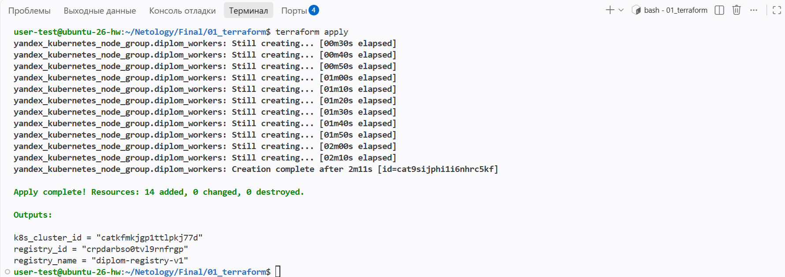
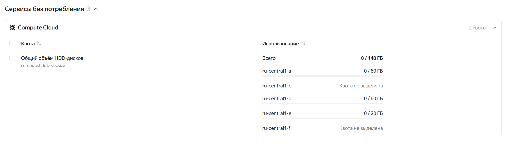
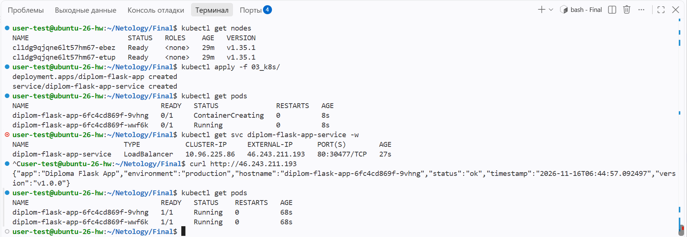
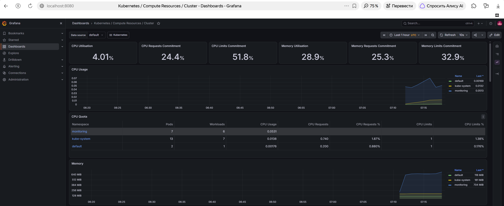
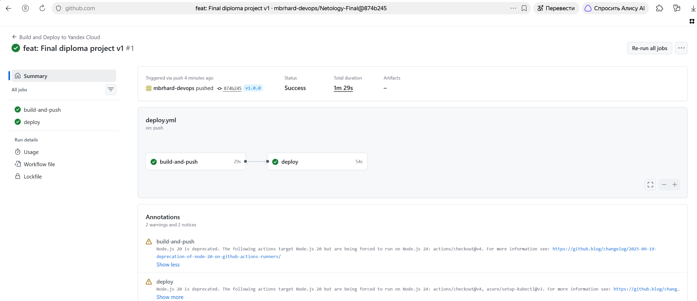
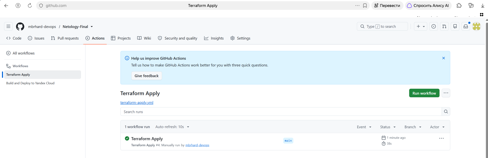

# Дипломный практикум в Yandex.Cloud - `Маховский Виктор`
  * [Цели:](#цели)
  * [Этапы выполнения:](#этапы-выполнения)
     * [Создание облачной инфраструктуры](#создание-облачной-инфраструктуры)
     * [Создание Kubernetes кластера](#создание-kubernetes-кластера)
     * [Создание тестового приложения](#создание-тестового-приложения)
     * [Подготовка cистемы мониторинга и деплой приложения](#подготовка-cистемы-мониторинга-и-деплой-приложения)
     * [Установка и настройка CI/CD](#установка-и-настройка-cicd)
  * [Что необходимо для сдачи задания?](#что-необходимо-для-сдачи-задания)
  * [Как правильно задавать вопросы дипломному руководителю?](#как-правильно-задавать-вопросы-дипломному-руководителю)

**Перед началом работы над дипломным заданием изучите [Инструкция по экономии облачных ресурсов](https://github.com/netology-code/devops-materials/blob/master/cloudwork.MD).**

---
## Цели:

1. Подготовить облачную инфраструктуру на базе облачного провайдера Яндекс.Облако.
2. Запустить и сконфигурировать Kubernetes кластер.
3. Установить и настроить систему мониторинга.
4. Настроить и автоматизировать сборку тестового приложения с использованием Docker-контейнеров.
5. Настроить CI для автоматической сборки и тестирования.
6. Настроить CD для автоматического развёртывания приложения.

---
## Этапы выполнения:


### Создание облачной инфраструктуры

Для начала необходимо подготовить облачную инфраструктуру в ЯО при помощи [Terraform](https://www.terraform.io/).

Особенности выполнения:

- Бюджет купона ограничен, что следует иметь в виду при проектировании инфраструктуры и использовании ресурсов;
Для облачного k8s используйте региональный мастер(неотказоустойчивый). Для self-hosted k8s минимизируйте ресурсы ВМ и долю ЦПУ. В обоих вариантах используйте прерываемые ВМ для worker nodes.

Предварительная подготовка к установке и запуску Kubernetes кластера.

1. Создайте сервисный аккаунт, который будет в дальнейшем использоваться Terraform для работы с инфраструктурой с необходимыми и достаточными правами. Не стоит использовать права суперпользователя
2. Подготовьте [backend](https://developer.hashicorp.com/terraform/language/backend) для Terraform:  
   а. Рекомендуемый вариант: S3 bucket в созданном ЯО аккаунте(создание бакета через TF)
   б. Альтернативный вариант:  [Terraform Cloud](https://app.terraform.io/)
3. Создайте конфигурацию Terrafrom, используя созданный бакет ранее как бекенд для хранения стейт файла. Конфигурации Terraform для создания сервисного аккаунта и бакета и основной инфраструктуры следует сохранить в разных папках.
4. Создайте VPC с подсетями в разных зонах доступности.
5. Убедитесь, что теперь вы можете выполнить команды `terraform destroy` и `terraform apply` без дополнительных ручных действий.
6. В случае использования [Terraform Cloud](https://app.terraform.io/) в качестве [backend](https://developer.hashicorp.com/terraform/language/backend) убедитесь, что применение изменений успешно проходит, используя web-интерфейс Terraform cloud.

Ожидаемые результаты:

1. Terraform сконфигурирован и создание инфраструктуры посредством Terraform возможно без дополнительных ручных действий, стейт основной конфигурации сохраняется в бакете или Terraform Cloud
2. Полученная конфигурация инфраструктуры является предварительной, поэтому в ходе дальнейшего выполнения задания возможны изменения.

---
### Создание Kubernetes кластера

На этом этапе необходимо создать [Kubernetes](https://kubernetes.io/ru/docs/concepts/overview/what-is-kubernetes/) кластер на базе предварительно созданной инфраструктуры.   Требуется обеспечить доступ к ресурсам из Интернета.

Это можно сделать двумя способами:

1. Рекомендуемый вариант: самостоятельная установка Kubernetes кластера.  
   а. При помощи Terraform подготовить как минимум 3 виртуальных машины Compute Cloud для создания Kubernetes-кластера. Тип виртуальной машины следует выбрать самостоятельно с учётом требовании к производительности и стоимости. Если в дальнейшем поймете, что необходимо сменить тип инстанса, используйте Terraform для внесения изменений.  
   б. Подготовить [ansible](https://www.ansible.com/) конфигурации, можно воспользоваться, например [Kubespray](https://kubernetes.io/docs/setup/production-environment/tools/kubespray/)  
   в. Задеплоить Kubernetes на подготовленные ранее инстансы, в случае нехватки каких-либо ресурсов вы всегда можете создать их при помощи Terraform.
2. Альтернативный вариант: воспользуйтесь сервисом [Yandex Managed Service for Kubernetes](https://cloud.yandex.ru/services/managed-kubernetes)  
  а. С помощью terraform resource для [kubernetes](https://registry.terraform.io/providers/yandex-cloud/yandex/latest/docs/resources/kubernetes_cluster) создать **региональный** мастер kubernetes с размещением нод в разных 3 подсетях      
  б. С помощью terraform resource для [kubernetes node group](https://registry.terraform.io/providers/yandex-cloud/yandex/latest/docs/resources/kubernetes_node_group)
  
Ожидаемый результат:

1. Работоспособный Kubernetes кластер.
2. В файле `~/.kube/config` находятся данные для доступа к кластеру.
3. Команда `kubectl get pods --all-namespaces` отрабатывает без ошибок.

---
### Создание тестового приложения

Для перехода к следующему этапу необходимо подготовить тестовое приложение, эмулирующее основное приложение разрабатываемое вашей компанией.

Способ подготовки:

1. Рекомендуемый вариант:  
   а. Создайте отдельный git репозиторий с простым nginx конфигом, который будет отдавать статические данные.  
   б. Подготовьте Dockerfile для создания образа приложения.  
2. Альтернативный вариант:  
   а. Используйте любой другой код, главное, чтобы был самостоятельно создан Dockerfile.

Ожидаемый результат:

1. Git репозиторий с тестовым приложением и Dockerfile.
2. Регистри с собранным docker image. В качестве регистри может быть DockerHub или [Yandex Container Registry](https://cloud.yandex.ru/services/container-registry), созданный также с помощью terraform.

---
### Подготовка cистемы мониторинга и деплой приложения

Уже должны быть готовы конфигурации для автоматического создания облачной инфраструктуры и поднятия Kubernetes кластера.  
Теперь необходимо подготовить конфигурационные файлы для настройки нашего Kubernetes кластера.

Цель:
1. Задеплоить в кластер [prometheus](https://prometheus.io/), [grafana](https://grafana.com/), [alertmanager](https://github.com/prometheus/alertmanager), [экспортер](https://github.com/prometheus/node_exporter) основных метрик Kubernetes.
2. Задеплоить тестовое приложение, например, [nginx](https://www.nginx.com/) сервер отдающий статическую страницу.

Способ выполнения:
1. Воспользоваться пакетом [kube-prometheus](https://github.com/prometheus-operator/kube-prometheus), который уже включает в себя [Kubernetes оператор](https://operatorhub.io/) для [grafana](https://grafana.com/), [prometheus](https://prometheus.io/), [alertmanager](https://github.com/prometheus/alertmanager) и [node_exporter](https://github.com/prometheus/node_exporter). Альтернативный вариант - использовать набор helm чартов от [bitnami](https://github.com/bitnami/charts/tree/main/bitnami).

### Деплой инфраструктуры в terraform pipeline

1. Если на первом этапе вы не воспользовались [Terraform Cloud](https://app.terraform.io/), то задеплойте и настройте в кластере [atlantis](https://www.runatlantis.io/) для отслеживания изменений инфраструктуры. Альтернативный вариант 3 задания: вместо Terraform Cloud или atlantis настройте на автоматический запуск и применение конфигурации terraform из вашего git-репозитория в выбранной вами CI-CD системе при любом комите в main ветку. Предоставьте скриншоты работы пайплайна из CI/CD системы.

Ожидаемый результат:
1. Git репозиторий с конфигурационными файлами для настройки Kubernetes.
2. Http доступ на 80 порту к web интерфейсу grafana.
3. Дашборды в grafana отображающие состояние Kubernetes кластера.
4. Http доступ на 80 порту к тестовому приложению.
5. Atlantis или terraform cloud или ci/cd-terraform
---
### Установка и настройка CI/CD

Осталось настроить ci/cd систему для автоматической сборки docker image и деплоя приложения при изменении кода.

Цель:

1. Автоматическая сборка docker образа при коммите в репозиторий с тестовым приложением.
2. Автоматический деплой нового docker образа.

Можно использовать [teamcity](https://www.jetbrains.com/ru-ru/teamcity/), [jenkins](https://www.jenkins.io/), [GitLab CI](https://about.gitlab.com/stages-devops-lifecycle/continuous-integration/) или GitHub Actions.

Ожидаемый результат:

1. Интерфейс ci/cd сервиса доступен по http.
2. При любом коммите в репозиторие с тестовым приложением происходит сборка и отправка в регистр Docker образа.
3. При создании тега (например, v1.0.0) происходит сборка и отправка с соответствующим label в регистри, а также деплой соответствующего Docker образа в кластер Kubernetes.

---
## Что необходимо для сдачи задания?

1. Репозиторий с конфигурационными файлами Terraform и готовность продемонстрировать создание всех ресурсов с нуля.
2. Пример pull request с комментариями созданными atlantis'ом или снимки экрана из Terraform Cloud или вашего CI-CD-terraform pipeline.
3. Репозиторий с конфигурацией ansible, если был выбран способ создания Kubernetes кластера при помощи ansible.
4. Репозиторий с Dockerfile тестового приложения и ссылка на собранный docker image.
5. Репозиторий с конфигурацией Kubernetes кластера.
6. Ссылка на тестовое приложение и веб интерфейс Grafana с данными доступа.
7. Все репозитории рекомендуется хранить на одном ресурсе (github, gitlab)

---

### Решение


## Архитектура и стек технологий

| Категория | Инструмент | Обоснование выбора |
|-----------|------------|-------------------|
| **IaC** | Terraform | Воспроизводимость инфраструктуры, версионирование состояния |
| **Orchestration** | Yandex Managed Kubernetes | Не нужно поддерживать Control Plane, нативная интеграция с облаком |
| **Containers** | Docker | Индустриальный стандарт, multi-stage build для минимизации размера |
| **Registry** | Yandex Container Registry | Безопасное хранение образов, бесшовная интеграция с K8s |
| **CI/CD** | GitHub Actions | Облачное решение, простая интеграция с репозиторием |
| **Monitoring** | kube-prometheus-stack (Helm) | Готовое решение из коробки (Prometheus + Grafana) |

## Структура репозитория

- `01_terraform/` — конфигурация облачной инфраструктуры (VPC, Kubernetes, Registry).
- `02_app/` — исходный код тестового приложения и Dockerfile.
- `03_k8s/` — Helm-чарты и манифесты для деплоя приложения и мониторинга.
- `.github/workflows/` — конфигурация CI/CD пайплайнов.

---

## Этапы

### 1 Создание облачной инфраструктуры (Terraform)
**Инструменты:** Terraform, Yandex Object Storage

**Что было сделано:**
- Вручную создан S3-бакет `diplom-tf-state-bucket-b1gep0` для хранения state-файла
- Настроен сервисный аккаунт с ролью `storage.admin`
- Описаны ресурсы: VPC, Managed Kubernetes кластер, Container Registry

---

<details>
<summary><b>Развернуть Terraform Plan / Apply</b></summary>    
<br />

```
user-test@ubuntu-26-hw:~/Netology/Final/01_terraform$ terraform plan
data.yandex_iam_service_account.existing_sa: Reading...
yandex_container_registry.diplom_registry: Refreshing state... [id=crpa96f3fkm8as7reahc]
data.yandex_iam_service_account.existing_sa: Read complete after 0s [id=ajecu62ss6pg8ita17cu]

Note: Objects have changed outside of Terraform

Terraform detected the following changes made outside of Terraform since the last "terraform apply" which may have affected this plan:

  # yandex_container_registry.diplom_registry has been deleted
  - resource "yandex_container_registry" "diplom_registry" {
      - id         = "crpa96f3fkm8as7reahc" -> null
      - name       = "diplom-registry-v1" -> null
        # (4 unchanged attributes hidden)
    }


Unless you have made equivalent changes to your configuration, or ignored the relevant attributes using ignore_changes, the following plan may include actions
to undo or respond to these changes.

────────────────────────────────────────────────────────────────────────────────────────────────────────────────────────────────────────────────────────────────

Terraform used the selected providers to generate the following execution plan. Resource actions are indicated with the following symbols:
  + create

Terraform will perform the following actions:

  # yandex_container_registry.diplom_registry will be created
  + resource "yandex_container_registry" "diplom_registry" {
      + created_at = (known after apply)
      + folder_id  = "b1gep0d4pp10h24g8gd0"
      + id         = (known after apply)
      + name       = "diplom-registry-v1"
      + status     = (known after apply)
    }

  # yandex_iam_service_account.k8s_sa will be created
  + resource "yandex_iam_service_account" "k8s_sa" {
      + created_at  = (known after apply)
      + description = "Service account for Managed Kubernetes cluster"
      + folder_id   = (known after apply)
      + id          = (known after apply)
      + name        = "diplom-k8s-sa"
    }

  # yandex_kubernetes_cluster.diplom_k8s will be created
  + resource "yandex_kubernetes_cluster" "diplom_k8s" {
      + cluster_ipv4_range       = (known after apply)
      + cluster_ipv6_range       = (known after apply)
      + created_at               = (known after apply)
      + description              = "Diploma Managed Kubernetes Cluster"
      + folder_id                = (known after apply)
      + health                   = (known after apply)
      + id                       = (known after apply)
      + labels                   = (known after apply)
      + log_group_id             = (known after apply)
      + name                     = "diplom-k8s-cluster"
      + network_id               = (known after apply)
      + node_ipv4_cidr_mask_size = 24
      + node_service_account_id  = (known after apply)
      + release_channel          = "STABLE"
      + service_account_id       = (known after apply)
      + service_ipv4_range       = (known after apply)
      + service_ipv6_range       = (known after apply)
      + status                   = (known after apply)

      + master {
          + cluster_ca_certificate = (known after apply)
          + etcd_cluster_size      = (known after apply)
          + external_v4_address    = (known after apply)
          + external_v4_endpoint   = (known after apply)
          + external_v6_endpoint   = (known after apply)
          + internal_v4_address    = (known after apply)
          + internal_v4_endpoint   = (known after apply)
          + public_ip              = true
          + version                = "1.35"
          + version_info           = (known after apply)

          + maintenance_policy (known after apply)

          + master_location (known after apply)

          + regional (known after apply)

          + zonal {
              + subnet_id = (known after apply)
              + zone      = "ru-central1-d"
            }
        }
    }

  # yandex_kubernetes_node_group.diplom_workers will be created
  + resource "yandex_kubernetes_node_group" "diplom_workers" {
      + cluster_id        = (known after apply)
      + created_at        = (known after apply)
      + description       = (known after apply)
      + id                = (known after apply)
      + instance_group_id = (known after apply)
      + labels            = (known after apply)
      + name              = "diplom-workers"
      + status            = (known after apply)
      + version           = (known after apply)
      + version_info      = (known after apply)

      + allocation_policy {
          + location {
              + subnet_id = (known after apply)
              + zone      = "ru-central1-d"
            }
          + location {
              + subnet_id = (known after apply)
              + zone      = "ru-central1-a"
            }
        }

      + deploy_policy (known after apply)

      + instance_template {
          + metadata                  = (known after apply)
          + nat                       = (known after apply)
          + network_acceleration_type = (known after apply)
          + platform_id               = "standard-v2"

          + boot_disk {
              + size = 30
              + type = "network-hdd"
            }

          + container_network (known after apply)

          + container_runtime (known after apply)

          + gpu_settings (known after apply)

          + network_interface {
              + ipv4       = true
              + ipv6       = (known after apply)
              + nat        = true
              + subnet_ids = (known after apply)
            }

          + resources {
              + core_fraction = 50
              + cores         = 2
              + gpus          = 0
              + memory        = 4
            }

          + scheduling_policy {
              + preemptible = true
            }
        }

      + maintenance_policy (known after apply)

      + scale_policy {
          + fixed_scale {
              + size = 2
            }
        }
    }

  # yandex_resourcemanager_folder_iam_binding.sa_viewer will be created
  + resource "yandex_resourcemanager_folder_iam_binding" "sa_viewer" {
      + folder_id = "b1gep0d4pp10h24g8gd0"
      + id        = (known after apply)
      + members   = [
          + "serviceAccount:ajecu62ss6pg8ita17cu",
        ]
      + role      = "viewer"
    }

  # yandex_resourcemanager_folder_iam_member.images_puller will be created
  + resource "yandex_resourcemanager_folder_iam_member" "images_puller" {
      + folder_id = "b1gep0d4pp10h24g8gd0"
      + id        = (known after apply)
      + member    = (known after apply)
      + role      = "container-registry.images.puller"
    }

  # yandex_resourcemanager_folder_iam_member.k8s_agent will be created
  + resource "yandex_resourcemanager_folder_iam_member" "k8s_agent" {
      + folder_id = "b1gep0d4pp10h24g8gd0"
      + id        = (known after apply)
      + member    = (known after apply)
      + role      = "k8s.clusters.agent"
    }

  # yandex_resourcemanager_folder_iam_member.k8s_compute_admin will be created
  + resource "yandex_resourcemanager_folder_iam_member" "k8s_compute_admin" {
      + folder_id = "b1gep0d4pp10h24g8gd0"
      + id        = (known after apply)
      + member    = (known after apply)
      + role      = "compute.admin"
    }

  # yandex_resourcemanager_folder_iam_member.k8s_lb_admin will be created
  + resource "yandex_resourcemanager_folder_iam_member" "k8s_lb_admin" {
      + folder_id = "b1gep0d4pp10h24g8gd0"
      + id        = (known after apply)
      + member    = (known after apply)
      + role      = "load-balancer.admin"
    }

  # yandex_resourcemanager_folder_iam_member.terraform_sa_storage_admin will be created
  + resource "yandex_resourcemanager_folder_iam_member" "terraform_sa_storage_admin" {
      + folder_id = "b1gep0d4pp10h24g8gd0"
      + id        = (known after apply)
      + member    = "serviceAccount:ajecu62ss6pg8ita17cu"
      + role      = "storage.admin"
    }

  # yandex_resourcemanager_folder_iam_member.vpc_public_admin will be created
  + resource "yandex_resourcemanager_folder_iam_member" "vpc_public_admin" {
      + folder_id = "b1gep0d4pp10h24g8gd0"
      + id        = (known after apply)
      + member    = (known after apply)
      + role      = "vpc.publicAdmin"
    }

  # yandex_vpc_network.diplom_net will be created
  + resource "yandex_vpc_network" "diplom_net" {
      + created_at                = (known after apply)
      + default_security_group_id = (known after apply)
      + folder_id                 = (known after apply)
      + id                        = (known after apply)
      + labels                    = (known after apply)
      + name                      = "diplom-network"
      + subnet_ids                = (known after apply)
    }

  # yandex_vpc_subnet.subnet_a will be created
  + resource "yandex_vpc_subnet" "subnet_a" {
      + created_at     = (known after apply)
      + folder_id      = (known after apply)
      + id             = (known after apply)
      + labels         = (known after apply)
      + name           = "diplom-subnet-a"
      + network_id     = (known after apply)
      + v4_cidr_blocks = [
          + "10.1.0.0/24",
        ]
      + v6_cidr_blocks = (known after apply)
      + zone           = "ru-central1-a"
    }

  # yandex_vpc_subnet.subnet_d will be created
  + resource "yandex_vpc_subnet" "subnet_d" {
      + created_at     = (known after apply)
      + folder_id      = (known after apply)
      + id             = (known after apply)
      + labels         = (known after apply)
      + name           = "diplom-subnet-d"
      + network_id     = (known after apply)
      + v4_cidr_blocks = [
          + "10.1.2.0/24",
        ]
      + v6_cidr_blocks = (known after apply)
      + zone           = "ru-central1-d"
    }

Plan: 14 to add, 0 to change, 0 to destroy.

Changes to Outputs:
  + k8s_cluster_id = (known after apply)
  + registry_id    = (known after apply)
  + registry_name  = "diplom-registry-v1"

────────────────────────────────────────────────────────────────────────────────────────────────────────────────────────────────────────────────────────────────

Note: You didn't use the -out option to save this plan, so Terraform can't guarantee to take exactly these actions if you run "terraform apply" now.
```


> **Результат:** Инфраструктура успешно создана. 14 ресурсов добавлены без ошибок.



</details>

---

### 2 Развертывание Kubernetes кластера
**Инструменты:** Yandex Managed Kubernetes

**Что было сделано:**
- Развёрнут Managed Kubernetes кластер с node group в доступных зонах.
- Получен `kubeconfig` для управления через `kubectl`.

> **Ограничение инфраструктуры:** 
> Был запрошен пересмотр квот. В зонах `ru-central1-a` и `ru-central1-d` квоты были увеличены. 
> В зонах `ru-central1-b` и `ru-central1-e` пришел отказ от Yandex Cloud (ресурсы региона исчерпаны). 
> Работаем с тем что есть - кластер успешно развернут в доступных зонах, что обеспечивает необходимую отказоустойчивость.



---

### 3 Контейнеризация приложения
**Инструменты:** Docker, Python Flask, Yandex Container Registry

**Что было сделано:**
- Разработано тестовое Flask-приложение, отдающее JSON-ответ со статусом и версией.
- Создан многоэтапный (`multi-stage`) `Dockerfile` для минимизации размера финального образа и повышения безопасности (исключение инструментов сборки из продакшен-образа).
- Образ собран с флагами `--no-cache --platform linux/amd64 --provenance=false --sbom=false` для избежания ошибок кэширования и совместимости.
- Образ успешно загружен в приватный Yandex Container Registry (`crpdarbso0tvl9rnfrgp`) с тегом `v1.0.0`.

> **Результат:** Готовый Docker-образ доступен в реестре и готов к деплою в кластер.

---


---

### 4 Деплой приложения и настройка системы мониторинга
**Инструменты:** Kubernetes (kubectl), Helm, kube-prometheus-stack

**Что было сделано:**
1. Обновлен манифест `deployment.yaml` с актуальным путем к образу в Container Registry.
2. Применены конфигурации Kubernetes: `kubectl apply -f 03_k8s/`.
3. Проверен статус подов и получен внешний IP-адрес сервиса типа `LoadBalancer`.
4. Установлен стек мониторинга через Helm: 
   `helm install prometheus prometheus-community/kube-prometheus-stack --namespace monitoring`
5. Настроен доступ к веб-интерфейсу Grafana через `kubectl port-forward` (или через выделенный LoadBalancer/NodePort).

> **Результат:** 
> - 2 реплики приложения успешно работают в разных зонах доступности.
> - Приложение доступно из интернета по внешнему IP-адресу.
> - Метрики кластера собираются и визуализируются в Grafana.

<details>
<summary><b>Развернуть проверку деплоя (kubectl & curl)</b></summary>  
<br />

```
# Проверка узлов кластера
kubectl get nodes
NAME                          STATUS   ROLES    AGE   VERSION
cil1dg9qjqne6lt57hm67-ebez   Ready    <none>   29m   v1.35.1
cil1dg9qjqne6lt57hm67-etup   Ready    <none>   29m   v1.35.1

# Деплой манифестов приложения
kubectl apply -f 03_k8s/
deployment.apps/diplom-flask-app created
service/diplom-flask-app-service created

# Ожидание выдачи внешнего IP сервисом LoadBalancer
kubectl get svc diplom-flask-app-service
NAME                       TYPE           CLUSTER-IP     EXTERNAL-IP      PORT(S)        AGE
diplom-flask-app-service   LoadBalancer   10.96.225.86   46.243.211.193   80:30477/TCP   27s

# Проверка ответа приложения по публичному IP
curl http://46.243.211.193
{"app":"Diploma Flask App","environment":"production","hostname":"diplom-flask-app-6fc4cd869f-9vhng","status":"ok","timestamp":"2026-11-16T06:44:57.092497","version":"v1.0.0"}

# Финальный статус подов — обе реплики готовы
kubectl get pods
NAME                                READY   STATUS    RESTARTS   AGE
diplom-flask-app-6fc4cd869f-9vhng   1/1     Running   0          68s
diplom-flask-app-6fc4cd869f-wwf6k   1/1     Running   0          68s

```



</details>

<br />

<details>
<summary><b>Развернуть установку и настройку мониторинга (Helm)</b></summary>  
<br />

```
# Создаем отдельное пространство имен
kubectl create namespace monitoring
namespace/monitoring created

# Добавляем официальный репозиторий и обновляем список чартов
helm repo add prometheus-community https://prometheus-community.github.io/helm-charts
helm repo update
Update Complete. ⎈Happy Helming!⎈

# Устанавливаем kube-prometheus-stack
helm install prometheus prometheus-community/kube-prometheus-stack --namespace monitoring
NAME: prometheus
LAST DEPLOYED: Mon Nov 16 07:10:01 2026
NAMESPACE: monitoring
STATUS: deployed
REVISION: 1

# Проверяем статус подов мониторинга
kubectl get pods -n monitoring
NAME                                                     READY   STATUS    RESTARTS   AGE
alertmanager-prometheus-kube-prometheus-alertmanager-0   2/2     Running   0          31s
prometheus-grafana-6c7568ddb9-pfkcb                      2/3     Running   0          44s
prometheus-kube-prometheus-operator-6c55c8d49-tf6z7      1/1     Running   0          44s
prometheus-kube-state-metrics-cf44899f7-xv4v9            1/1     Running   0          44s
prometheus-prometheus-kube-prometheus-prometheus-0       2/2     Running   0          30s
prometheus-prometheus-node-exporter-vsljz                1/1     Running   0          44s
prometheus-prometheus-node-exporter-z5hk8                1/1     Running   0          44s

# Получаем автоматически сгенерированный пароль для Grafana (логин: admin)
kubectl get secret --namespace monitoring prometheus-grafana -o jsonpath="{.data.admin-password}" | base64 --decode ; echo
jk6ZLQ02grvmYnTfsrz5MHVpVAlXgjlXQW8GN7sT


```

P.S. Для доступа из браузера выполнен проброс порта: kubectl port-forward svc/prometheus-grafana 8080:80 -n monitoring



</details>


---

### 5 Установка и настройка CI/CD
**Инструменты:** GitHub Actions, Docker, Yandex Cloud CLI, kubectl

**Что было сделано:**
1. Создан конфигурационный файл `.github/workflows/deploy.yml` для автоматизации доставки приложения.
2. Настроен триггер запуска пайплайна **только при создании тега** версии (например, `v1.0.0`), что соответствует лучшим практикам релизного цикла.
3. Реализован двухэтапный процесс (Jobs):
   - **build-and-push:** устанавливает YC CLI, аутентифицируется через сервисный аккаунт, собирает Docker-образ с тегом, равным хэшу коммита (`github.sha`), и отправляет его в Yandex Container Registry.
   - **deploy:** подключается к Managed Kubernetes (с явным указанием эндпоинта `:443`), обновляет образ в Deployment через `kubectl set image` и дожидается успешного завершения развертывания (`rollout status`).
4. В настройках репозитория (GitHub Secrets) безопасно сохранены чувствительные данные: для деплоя приложения: `YC_SA_JSON`, `YC_REGISTRY_ID`, `YC_CLUSTER_ID` и для доступа к S3-бэкенду Terraform: `AWS_ACCESS_KEY_ID`, `AWS_SECRET_ACCESS_KEY`.

> **Результат:** 
> Полностью автоматизированный процесс доставки. Для выпуска новой версии достаточно создать и запушить тег. Сборка и деплой занимают ~1.5 минуты без ручного вмешательства.

<details>
<summary><b>Развернуть процесс запуска и логи CI/CD</b></summary>    
<br />

```
# Локальная подготовка релиза и запуск пайплайна
$ git add .
$ git commit -m "feat: update application v1"
$ git push origin main

# Создание тега версии
$ git tag v1.0.0
$ git push origin v1.0.0

```
В интерфейсе GitHub Actions пайплайн успешно выполняет оба джоба:
> build-and-push (Checkout → Install YC CLI → Login → Build → Push)
> deploy (Checkout → Install YC CLI → Login → Setup kubectl → Get Credentials → Update Deployment)



</details>

---

### 6 Автоматизация Terraform (CI/CD для инфраструктуры)
**Инструменты:** GitHub Actions, Terraform, Yandex Object Storage

**Что было сделано:**
1. Создан пайплайн `.github/workflows/terraform-apply.yml`.
2. Триггер — коммит в `main` с изменениями в `01_terraform/**`, либо ручной запуск через `workflow_dispatch`.
3. Пайплайн устанавливает YC CLI, аутентифицирует сервисный аккаунт, выполняет `terraform init` (с бэкендом S3) и `terraform apply -auto-approve`.

> **Результат:**
> Инфраструктура синхронизируется с кодом автоматически. Поскольку состояние уже актуально, плановый прогон даёт `Apply complete! Resources: 0 added, 0 changed, 0 destroyed` — подтверждение идемпотентности и корректности конфигурации.




## Доступы для проверки

- **Репозиторий:** https://github.com/mbrhard-devops/Netology-Final
- **CI/CD (Actions):** https://github.com/mbrhard-devops/Netology-Final/actions
- **Тестовое приложение (HTTP):** http://46.243.211.193
- **Grafana:** через `kubectl port-forward svc/prometheus-grafana 8080:80 -n monitoring` (логин `admin`)

---

